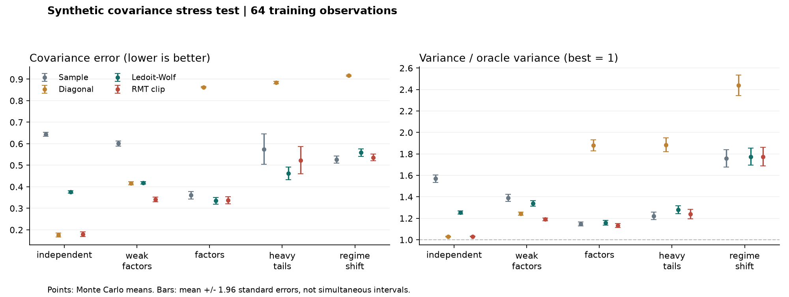
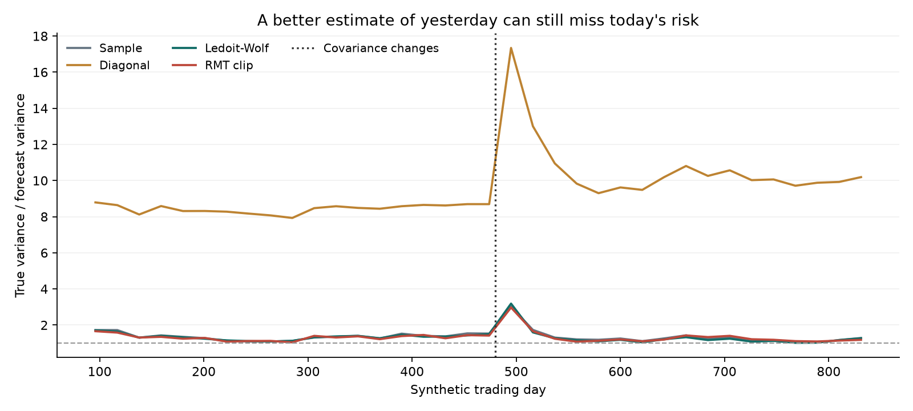

# Covariance Shift Lab

**When does cleaning a correlation matrix help, and when does it hide risk?**

Portfolio risk depends on how assets move together. With limited data, those
relationships are noisy. With changing markets, they may already be out of date.
This project separates those two problems using synthetic returns whose true
covariance is known.

It compares four estimates: sample covariance, a diagonal baseline, Ledoit-Wolf
shrinkage, and a conservative random-matrix eigenvalue-clipping rule. Each feeds
the same long-only minimum-variance allocation. A separate rolling experiment
checks risk forecasts, drifted holdings, and transaction costs through a sudden
covariance change.

This is a new implementation and simulation study, not a fork or a historical
trading strategy. The mathematical methods are established; no new theorem or
guaranteed investment improvement is claimed.

## Evidence

In the default run, RMT clipping reduced covariance error for weak factors at
64 observations from 0.601 to 0.342 relative to the sample estimate. But after a
regime change at 160 observations, its variance/oracle ratio was 1.685 versus
1.646 for the sample estimate. Less estimation noise did not consistently mean
better allocation. These are averages across 60 trials, not market results.



The experiment covers independent assets, weak factors, stronger factors,
heavy-tailed returns, and a covariance change. It includes an undersampled case
with more assets than training observations. Every method sees the same data
within a trial.

- [Full tables and limitations](results/summary.md)
- [Paired bootstrap comparisons](results/paired_comparisons.csv)
- [Raw trial-level results](results/trials.csv)
- [Seed, dependency versions, and source hashes](results/manifest.json)



## Reproduce

Requires Python 3.11 or newer. No API key, data download, or GPU is needed.

```bash
python -m venv .venv
source .venv/bin/activate
python -m pip install -e '.[test]'
python -m pytest -q
OPENBLAS_NUM_THREADS=1 OMP_NUM_THREADS=1 covariance-shift --output results
```

The default study uses 32 assets, training windows of 24, 64, and 160 observations,
60 trials per scenario/window, and seed 20261026: 900 datasets and 3,600 estimator
evaluations. The rolling example is separate: 24 assets, 840 days, a change at day
480, a 96-day window, and rebalancing every 21 days. A short smoke run is:

```bash
covariance-shift --assets 8 --windows 12 24 --repeats 3 --output /tmp/covariance-smoke
```

Use a different output directory to avoid replacing the checked-in evidence.
The manifest records the exact installed scientific-library versions; small
floating-point differences across platforms are expected.

The initial release passed 43 automated tests, including future-data isolation,
positive semidefiniteness, the MP atom/continuous-mass convention, t-noise scaling,
and drift-aware transaction costs. See [computational checks](computational_checks.md).

## What Is Measured

| Quantity | Meaning |
|---|---|
| Relative covariance error | Frobenius error against the known future covariance, divided by its norm |
| Variance / oracle variance | True portfolio variance relative to a portfolio given the future covariance |
| True / forecast variance | Greater than one means the estimate understated the portfolio's risk |
| Turnover and costs | Total bought plus sold notional, using holdings after their returns have drifted |

The oracle is an evaluation reference only. It never sets the clipping threshold,
chooses a method, or supplies information to the rolling allocation.

## Methods and Limits

The RMT rule uses the upper Marchenko-Pastur edge for unit-variance independent
noise. Eigenvalues below that edge are replaced by their mean, then the
correlation diagonal is restored to one. This is deliberately simple and
conservative: the edge is not fitted to the data and can miss weak factors.
It is an asymptotic reference, not a finite-sample test or a guarantee under
heavy tails and changing covariance. Sample variances are not denoised.

All simulations have zero expected return. Cost and wealth figures are accounting
diagnostics on one synthetic path, not evidence of alpha or real-market results.
The bootstrap intervals are exploratory and are not corrected for multiple
comparisons. See [definitions and assumptions](definitions.md).

## Layout

```text
src/covariance_shift/   estimators, simulation, allocation, experiment runner
tests/                 numerical invariants, timing, costs, reproducibility
scripts/reproduce.py   alternative experiment entry point
results/               generated CSVs, figures, summary, and manifest
```

## References

- Laloux, Cizeau, Bouchaud, and Potters (1999),
  [Noise Dressing of Financial Correlation Matrices](https://arxiv.org/abs/cond-mat/9810255).
- Ledoit and Wolf (2004),
  [A Well-Conditioned Estimator for Large-Dimensional Covariance Matrices](https://www.ledoit.net/Well-conditioned2004.pdf).
- The shrinkage baseline uses the documented
  [scikit-learn LedoitWolf implementation](https://scikit-learn.org/stable/modules/generated/sklearn.covariance.LedoitWolf.html).

## Provenance

Created as a separate project on October 26, 2026. Source code, tests, and
documentation were developed here with coding-assistant support. No source,
notebooks, prose, figures, datasets, or experimental results were copied from
another project repository. Standard research methods and library dependencies
are credited above. Generated results come from the included scripts, not from
an earlier research archive. This is an initial computational study, not a
peer-reviewed result.

MIT licensed; see [LICENSE](LICENSE).
